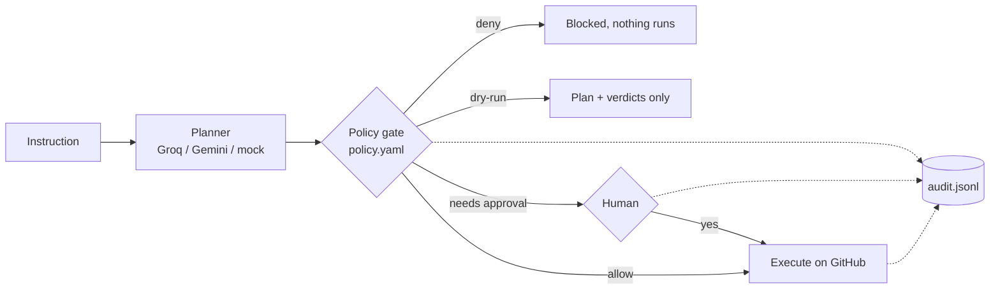

# GitHub Autonomous Platform Agent

[](https://github.com/ashiksharonm/autonomous-platform-intelligent-agent/actions/workflows/ci.yml)

An agent that turns a natural-language instruction into GitHub API operations, with a **policy-as-code safety gate** in front of every write: a YAML policy (allowed repos and ops, maximum blast radius, ops that need a human) is evaluated against the whole plan before anything runs, then dry-run output, an approval step, and an append-only, hash-chained JSONL audit log with request ids. The agent also stores what it learns (failure constraints, working plans, synthesized capabilities) so later runs of the same kind of task make fewer calls.

Built as a take-home exercise; extended afterwards (sandbox hardening, accounting fixes, offline harness, CI, and the policy gate). Design: [docs/DESIGN.md](docs/DESIGN.md).



## Policy gate

```yaml
# policies/default.yaml (abridged)
allowed_repos: ["demo/sandbox-repo", "ashiksharonm/*"]
allowed_ops: [create_issue, ensure_label_exists, add_labels_to_issue, comment_on_issue, find_stale_labeled_issues]
read_only_ops: [find_stale_labeled_issues]   # not counted as writes
max_blast_radius: 4        # more write steps than this: denied
approve_above: 2           # more than this: needs a human
require_approval: [comment_on_issue]
synthesized_code: require_approval   # LLM-written code: deny | require_approval | allow
```

```bash
python main.py run "Create 6 issues titled 'Spam'" --policy policies/default.yaml      # exit 3: blocked
python main.py run "Comment on issue #1 saying 'hi'" --policy policies/default.yaml    # asks y/N (or --yes)
python main.py run "..." --policy policies/default.yaml --dry-run                      # plan only
python main.py verify-audit data/audit.jsonl                                           # hash chain check
```

Verdicts for the hosted demo's sample prompts (asserted in `tests/test_demo_service.py`):

| Prompt | Verdict | Why |
|---|---|---|
| Create an issue titled 'Fix login bug' with label 'bug' | allow | 1 write, allowed op |
| Comment on issue #1 saying 'Looking into this' | needs approval | `comment_on_issue` in `require_approval` |
| Create 6 issues titled 'Spam' | deny | 6 writes > `max_blast_radius` 4 |
| Close all issues in the repo | deny | `close_all_issues` not in `allowed_ops` |
| Generate this week's triage summary | needs approval | LLM-synthesized code |
| Find stale issues labeled 'bug' | allow | read-only |

The gate decides on the whole plan, so a denied plan executes nothing, not even its read steps. It fails closed: a malformed policy exits 2 without running, unknown ops count as writes, and a missing approver means reject. It is plan-level policy, not a sandbox: an allowed write still does what the token can do, and the audit log can detect edits or removal in the middle but not truncation of the newest lines.

**Free hosted demo:** a Gradio app (`app.py`) runs the gate over an in-memory mock GitHub with a keyword planner (not an LLM), so no token or key is needed. Run it locally with `python app.py` or `docker compose up` (port 7860). `.github/workflows/deploy-space.yml` pushes it to a Hugging Face Space once `HF_TOKEN` (secret) and `HF_SPACE` (variable) are set; no public URL is live yet.

**LLM providers (free options):** `LLM_PROVIDER=auto` uses Groq if `GROQ_API_KEY` is set, else Gemini if `GEMINI_API_KEY` is set, else the deterministic mock. The Gemini path is covered by a request-shape unit test only; it has not been run against the live API.

## Demo (offline, recorded)

There are no LLM or GitHub keys on the machine this was last worked on, so the demo below runs the real agent loop (decomposer → memory guard → executor → SQLite memory) against an in-memory fake GitHub and a scripted LLM stub. It is a recorded transcript, not a live run. Full output: [`results/offline_demo_transcript.txt`](results/offline_demo_transcript.txt).

```
# excerpt of results/offline_demo_transcript.txt; each simulated run is printed the way `python main.py run` would print it
$ python main.py run "Create an issue titled 'Bug report 1' with label 'needs-triage'"    # run 1, label missing
Total API calls: 5
  [0] create_issue -> ok (api_calls=5)
      agent_decision: step failed validation; will attempt a targeted fix (e.g. create missing label)
                      and retry once ... (recovered: created missing label then retried)

$ python main.py run "Create an issue titled 'Bug report 2' with label 'needs-repro'"     # run 2, another new label
Total API calls: 4
  [0] ensure_label_exists -> ok (api_calls=3)     <- inserted by the executor from the learned constraint
  [1] create_issue -> ok (api_calls=1)
```

The scripted planner ignores the memory hints in its prompt and returns the same one-step plan every time. Any change between runs therefore comes from the agent's own code and not from the "LLM".

## How it works

```
instruction ─► decomposer (LLM: Groq, llama-3.3-70b-versatile)
                 │  tool catalog + known constraints + memory guidance in prompt
                 ▼
               executor.apply_memory_guard()   ← plain Python, reads SQLite memory
                 │  swaps in last known-good plan if an op fails >50% for this task_type
                 │  inserts ensure_label_exists once "label must exist" has been learned
                 ▼
               run_single_step() ── built-in PyGithub tools
                 │              └─ NEEDS_SYNTHESIS → synthesis.py → sandbox (AST allowlist,
                 │                 restricted builtins/imports, child process + rlimits)
                 ▼
               memory (SQLite): capabilities, runs, steps   ─► python main.py stats <task_type>
```

See [ARCHITECTURE.md](ARCHITECTURE.md) for the design reasoning.

## Results (offline harness)

Every number below comes from `python scripts/offline_learning_demo.py` ([`results/offline_learning_demo.json`](results/offline_learning_demo.json)) or, for the "before" column, from `scripts/baseline_before_fix.py` run against the original commit `5903c51` ([`results/baseline_before_fix.json`](results/baseline_before_fix.json)). GitHub is a fake that counts REST calls, and the LLM is a scripted stub. These are call counts, not latencies.

`create_labeled_issue`, where runs 1–3 each use a label that doesn't exist yet and run 4 reuses one:

| run | GitHub calls, original code (5903c51) | calls the original code *reported* | GitHub calls, this branch | calls this branch reports | LLM planning calls, this branch |
|---|---|---|---|---|---|
| 1 (new label) | 6 | 3 | 5 | 5 | 1 |
| 2 (new label) | 6 | 3 | 4 | 4 | 2 |
| 3 (new label) | 6 | 3 | 4 | 4 | 2 |
| 4 (existing label) | 2 | 2 | 3 | 3 | 2 |

How to read this:
- The original code showed no learning effect when the LLM ignored the prompt hints. Its run reports also counted about half of the calls it actually made, because the failed first attempt was dropped and a 422-recovered step lost its `GET /repos`.
- On this branch a learned constraint saves one failed `POST /issues` per new label (5 → 4 calls). The trade-off is one extra `GET /labels/{name}` when the label already exists (run 4: 3 calls vs 2). Once memory exists, the decomposer also makes a **second LLM planning call** per run (1 → 2).
- The old claim of "4 calls drop to 1–2" is not supported by these numbers and has been removed.

`triage_summary_by_label_and_staleness` (capability synthesis):

| run | LLM code-generation calls | GitHub calls |
|---|---|---|
| 1 (synthesize, dry-run, execute) | 1 | 4 |
| 2 (reuse stored capability) | 0 | 3 |

The earlier "9–12 s → ~1 s" latency claim was never measured and has been removed. Real latency needs a live LLM and GitHub; see "Not measured" below.

## Quickstart

Offline. No keys needed; this is what CI runs:

```
python -m venv .venv && source .venv/bin/activate
pip install -r requirements-dev.txt
ruff check . && pytest -q                       # 114 tests
python scripts/offline_learning_demo.py         # regenerates results/
```

Live, against a scratch repo you own. This makes real writes, so never point it at a repo you care about:

```
cp .env.example .env    # GROQ_API_KEY, GITHUB_TOKEN (issues read/write on the scratch repo), GITHUB_REPO=owner/repo
python main.py run "Create an issue titled 'Fix login bug' with label 'needs-triage' on the repo"
python main.py stats create_labeled_issue
python main.py show-capabilities
```

Memory lives in `data/agent_memory.sqlite` and is never wiped automatically. `scripts/reset_demo_repo.py` closes **every** open issue on `GITHUB_REPO`. It's a demo cleanup tool and isn't part of the agent.

Try the gate with no keys at all:

```
GITHUB_MODE=mock LLM_PROVIDER=mock python main.py run "Create an issue titled 'Hi' with label 'bug'" --policy policies/default.yaml
python app.py                                   # Gradio demo on :7860
```

In mock mode each CLI process starts with a fresh fake repo; the demo app keeps one per process.

## Running LLM-generated code: threat model

Synthesized capabilities are Python written by the LLM and executed by the agent. The defences are layered and best-effort ([`agent/sandbox.py`](agent/sandbox.py)):

1. **AST allowlist.** Only listed node types are accepted (no classes, `with`, `yield`, `async`, `global`). Dunder or `_private` names, attributes and dunder-containing strings are rejected, as are frame, generator and traceback attributes (`gi_frame`, `f_globals`, `tb_frame`, ...), `str.format`/`format_map`, and any import outside `datetime`/`collections`/`re`. Every alias is checked.
2. **Restricted runtime.** The code gets a small builtins dict with no `getattr`, `type`, `vars`, `eval` or `open`. A restricted `__import__` returns public views of the allowed modules with their submodules stripped, so `re.enum.sys` cannot be reached.
3. **Separate process.** By default the code runs in `agent/sandbox_runner.py` with a wall-clock timeout (`AGENT_SANDBOX_TIMEOUT_S`, default 30 s), CPU, file-size and open-file rlimits (plus address-space and process limits on Linux), and an environment scrubbed down to `PATH`, `GITHUB_TOKEN` and `GITHUB_REPO`.

**In-process Python sandboxing is not a security boundary.** The code also receives a live, authenticated PyGithub `repo`, so it can do anything that token can do on GitHub. This setup is meant for one user running their own agent against their own scratch repo. For anything else, run the agent (or at least the runner) in a container or VM with no host filesystem access and network egress limited to `api.github.com`. The regression tests in `tests/test_synthesis_sandbox.py` cover the escapes that are known to have worked, among them the `getattr(getattr(params, "__class__"), "__mro__")` chain that previously reached `object.__subclasses__()`.

## Limitations / not measured

- **Policy gate:** tested with a mock GitHub and a keyword planner; it has not been exercised against live GitHub or a live model. The keyword planner only understands the sample instruction shapes.
- Blast radius counts write steps, not how much one step touches (for example a synthesized function that edits many issues); that is why synthesized code defaults to needing approval.
- The Docker image could not be built on the author's machine (no running Docker daemon at the time); the CI `docker` job builds it and probes `/healthz`.

- **No live runs in this revision.** There were no Groq or GitHub keys, and live writes were deliberately avoided. Every LLM response in tests and the demo is scripted. The synthesized triage function in `agent/fake_github.py` was written by hand to stand in for model output; it is not a recorded response.
- **The 422-on-missing-label premise is unverified.** The fake rejects `POST /issues` with an unknown label, which is the assumption the agent was designed around. Real GitHub may instead auto-create the label for users with push access, in which case the constraint-learning path never triggers for this task.
- Latency (LLM or GitHub) is not measured anywhere in this repo.
- The decomposer makes a second LLM call whenever memory guidance exists for the task type.
- Planning is linear, with no replanning loop. Task-type matching is exact-string, so a misclassified instruction gets no benefit from memory.
- Only one synthesized capability (`triage_summary_by_label_and_staleness`) has been exercised.
