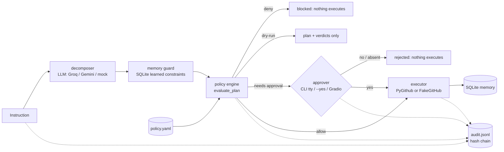
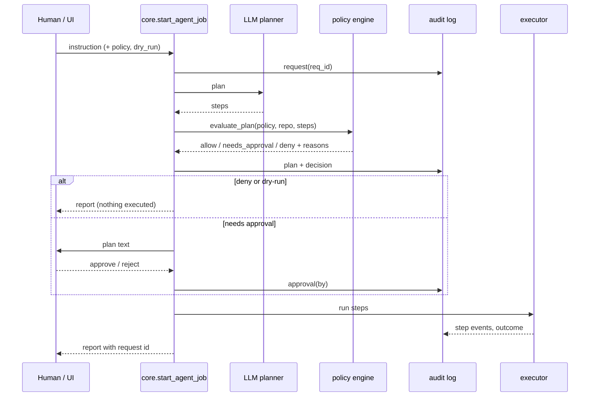

# Design: policy-gated GitHub agent

## Problem
An agent that turns natural language into GitHub writes is only as safe as the model's judgement. Prompt
instructions are not a control. We want a gate that is deterministic, reviewable as code, evaluated before any
write, and leaves an audit trail a human can trust.

## Requirements
**Functional**
- A YAML policy defines allowed repos, allowed ops, maximum blast radius, and ops that need human approval.
- The whole plan is evaluated before the first step runs; a denied plan executes nothing (not even reads).
- Dry-run prints the plan with a per-step verdict and executes nothing.
- Approval step for plans that need it; the gate fails closed when no approver exists.
- Append-only JSONL audit log; every event carries a request id; tamper-evident.
- Free to run: Groq or Gemini free tier, or a deterministic mock planner; mock GitHub needs no token.

**Non-functional**
- Fail closed: malformed policy refuses to run; unknown ops and unknown synthesized code count as writes.
- No policy given = previous behaviour (backward compatible).
- Deterministic tests: no network, no model.

## Architecture

## Data model
- `Policy` (frozen): `allowed_repos` (fnmatch), `allowed_ops`, `read_only_ops`, `max_blast_radius`,
  `approve_above`, `require_approval`, `synthesized_code` in {deny, require_approval, allow}.
- `PlanDecision`: overall verdict, write count, per-step `StepDecision` with reasons.
- Audit record: `seq, ts, request_id, event, ...fields, prev_hash, hash`, where
  `hash = sha256(prev_hash + canonical_json(record_without_hash))`.
- Events: `request`, `plan`, `blocked`, `dry_run`, `approval`, `step`, `outcome`.

## Interfaces
- CLI: `python main.py run "<instruction>" --policy policies/default.yaml [--dry-run] [--yes] [--audit-log PATH] [--request-id ID]`;
  `python main.py verify-audit [PATH]`. Exit codes: 0 ok/dry-run, 1 execution failure, 2 policy error, 3 blocked or rejected.
- Library: `core.plan_job`, `core.gate`, `core.record_approval`, `core.execute_job`, `core.start_agent_job`.
- Demo: Gradio app on `/`, `GET /healthz`.

## Scaling path
This is a single-user tool. If shared: audit log to a write-once store or database with the same chain; policy
loaded from a signed or reviewed repo path; approvals via chat/PR instead of a terminal; per-user quotas. Not built.

## Failure modes
| Failure | Mitigation |
|---|---|
| Model proposes a destructive or unknown op | not in `allowed_ops`: whole plan denied before execution |
| Model splits a big change into many small steps | blast radius counts write steps per plan; `approve_above` adds a human checkpoint |
| Model writes code for a gap | `synthesized_code` defaults to `require_approval`; existing sandbox still applies |
| Policy file typo or missing key | `PolicyError`; the CLI exits 2 and runs nothing |
| No human available | no approver means reject |
| Someone edits the audit log | hash chain verification fails at the first modified or removed middle record |
| Process crash mid-run | audit events are fsynced per event; memory rows record completed steps |

## Security and privacy
The gate is plan-level policy, not a sandbox: a permitted write op can still do what the token can do, and
synthesized code that is approved runs with the same token (see the README threat model). Audit logs contain
instructions and parameters (issue titles, comments) but never tokens; files are created mode 0600. Truncating the
newest lines of the log is not detectable from the file alone. The hosted demo is mock-only and has no secrets.
Containers run as a non-root user. CodeQL and Dependabot are enabled.

## Decisions
- **ADR-1 plan-level gate, evaluated before execution.** Per-step checks would let early steps run before a later
  step is refused. Cost: policies cannot depend on results of earlier steps.
- **ADR-2 blast radius = number of write steps.** Simple, explainable, computable from the plan. It does not measure
  how much a single synthesized step touches; that is why synthesized code defaults to approval.
- **ADR-3 deny beats approval beats allow; unknown means write.** Fail closed everywhere.
- **ADR-4 hash chain over plain append.** Cheap tamper evidence without infrastructure; honest about tail truncation.
- **ADR-5 provider-agnostic LLM layer with a mock.** Groq and Gemini both have free tiers; tests and the hosted
  demo use a deterministic keyword planner so they cost nothing and never flake.

## Free-tier cost table
| Piece | Service | Cost |
|---|---|---|
| Hosted demo | Hugging Face Space (Gradio, free CPU) | 0 |
| LLM | Groq free tier, Gemini free tier, or mock | 0 |
| CI, CodeQL, image build | GitHub Actions | 0 (public repo) |
| Storage | SQLite + JSONL files | 0 |
